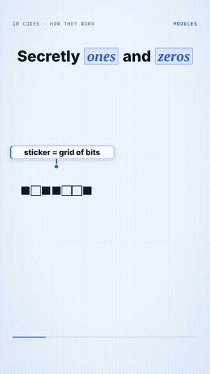

# MotionMint

Type one sentence, get a narrated, animated explainer video. English, Hindi or Hinglish.

I built the first working version in two days. The source code is private; this repo shows what it makes and how it works.

| UPI PIN (Hindi) | QR codes (English) |
|---|---|
|  |  |
| [Full video with sound](media/upi-pin-hindi.mp4) | [Full video with sound](media/qr-code-english.mp4) |

## What happens after you type a topic

1. **Research.** It looks the topic up in real sources so the facts are right.
2. **Script.** It writes a short script with a hook, a simple example and a clear ending. The UPI video explains payments through a chai stall owner named Ramu.
3. **Voice.** It records the narration in English, Hindi or Hinglish.
4. **Scenes.** It plans the video as one continuous scene, so the same objects stay on screen and move along with the voice instead of jumping between slides.
5. **Render.** It renders a vertical 1080×1920 video with captions, music and sound effects.
6. **Check.** It looks over the finished video for problems before the user gets it.

**Stack:** Hono on Cloudflare Workers, Claude, Azure Speech, Remotion, Azure Container Apps, Supabase / PostgreSQL, Cloudflare R2, PayU

## Some technical choices

**Pay only while rendering.** Videos render on Azure Container Apps jobs that start when there's work and shut down when there isn't, so there's no fixed server bill. Workers pick up jobs straight from Postgres:

```sql
-- Simplified idea, not the real code
select id from render_jobs
where status = 'queued'
order by created_at
for update skip locked
limit 1;
```

A 1.5 minute video costs about ₹70 to make.

**Credits that can't go wrong.** Credits live in Postgres. The balance has a check so it can never go below zero. Charges, refunds and purchases go through database functions that only the server can call, and each one has an idempotency key so a payment can't be counted twice. If a video fails, the credits come back automatically.

**Separate admin panel.** Usage, costs, users, payments and an activity log, running as its own app.

**Expiring links.** Videos sit in R2 and are shared through signed links that expire after an hour.

## What I learned

My first videos looked like slideshows: a new picture every few seconds. They only started to feel like real animation once I made the whole video one scene where things stay and move with the voice.

## Contact

Shivam Laur · proffesorrk@gmail.com · [LinkedIn](https://www.linkedin.com/in/shivam-kumar-28b40b306/)
