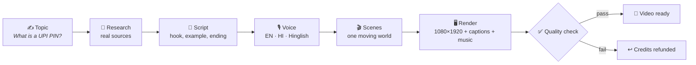
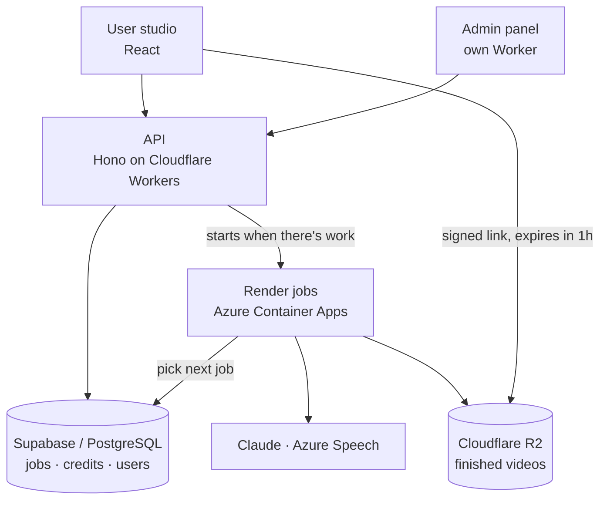

<h1 align="center">MotionMint</h1>

<p align="center">
<b>Type one sentence. Get a narrated, animated explainer video.</b><br>
English, Hindi or Hinglish. First working version built in 2 days.
</p>

<p align="center">


</p>

<table align="center">
<tr>
<th>UPI PIN (Hindi)</th>
<th>QR codes (English)</th>
</tr>
<tr>
<td></td>
<td></td>
</tr>
<tr>
<td align="center"><a href="media/upi-pin-hindi.mp4">▶ Watch with sound</a></td>
<td align="center"><a href="media/qr-code-english.mp4">▶ Watch with sound</a></td>
</tr>
</table>

> The source code is private. This repo shows what it makes and how it works.

---

## ✨ From one line to a finished video



The UPI video explains payments through Ramu's chai stall: your phone, your bank, the network in between, and why your PIN stays safe. The same objects stay on screen and move with the voice, so it feels like one animation instead of a slideshow.

---

## ⚙️ How it runs



| | |
|---|---|
| **Pay only while rendering** | Render jobs start when there's work and shut down when there isn't. No fixed server bill. About ₹70 per 1.5 minute video. |
| **Job queue in Postgres** | Workers grab the next job with `FOR UPDATE SKIP LOCKED`, so two workers never take the same one. |
| **Credits can't go wrong** | Balance can't drop below zero. Charges, refunds and purchases only run on the server, each with an idempotency key, so a payment is never counted twice. |
| **Auto refunds** | If a video fails, the credits come back on their own. |
| **Admin panel** | Usage, costs, users, payments and an activity log, as a separate app. |

```sql
-- Simplified idea, not the real code
select id from render_jobs
where status = 'queued'
order by created_at
for update skip locked
limit 1;
```

---

## 💭 What I learned

My first videos looked like slideshows, a new picture every few seconds. They only started to feel like real animation once the whole video became one scene where things stay and move with the voice.

---

<p align="center">
Shivam Laur · <a href="mailto:proffesorrk@gmail.com">proffesorrk@gmail.com</a> · <a href="https://www.linkedin.com/in/shivam-kumar-28b40b306/">LinkedIn</a>
</p>
