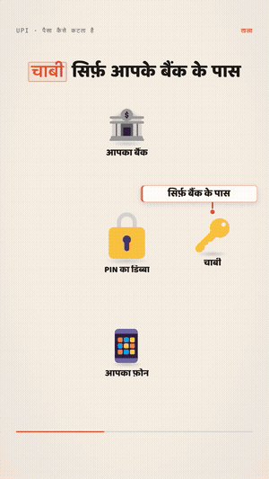
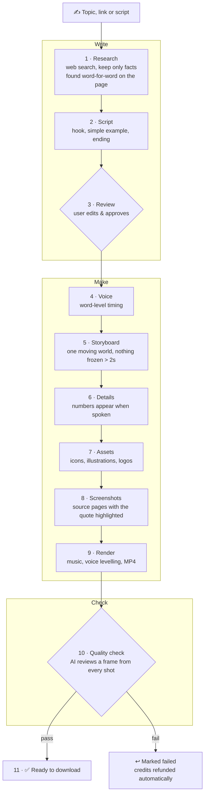
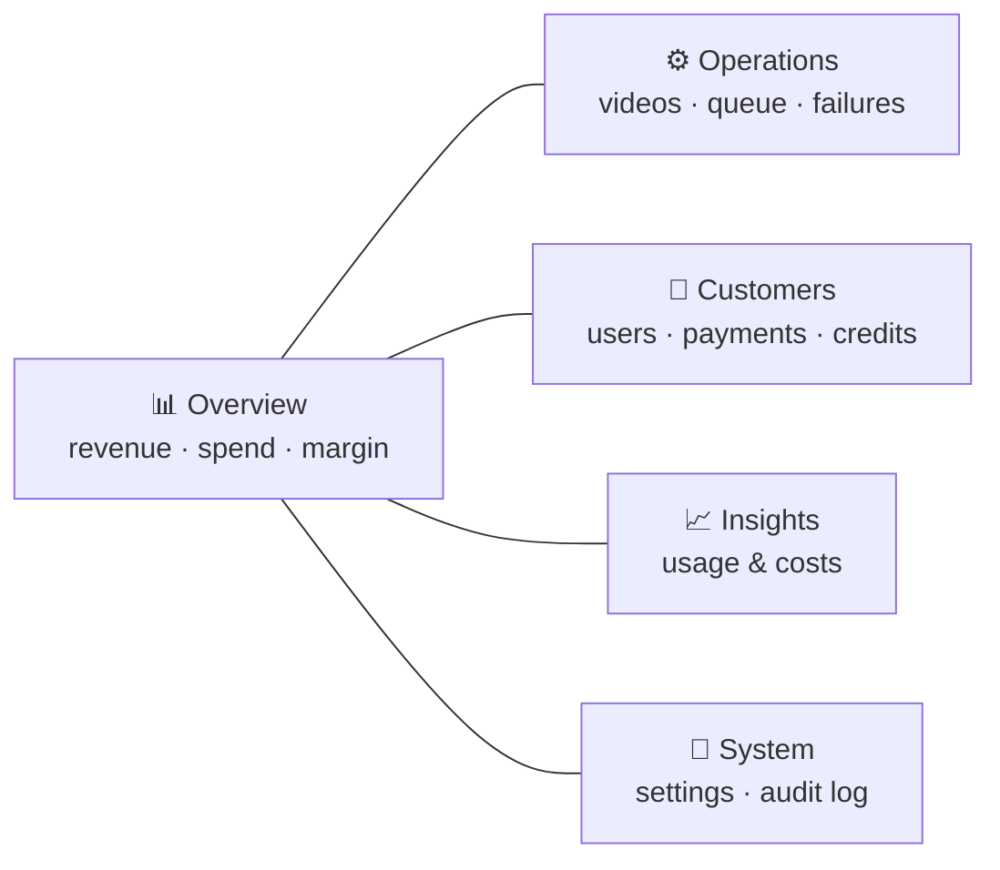
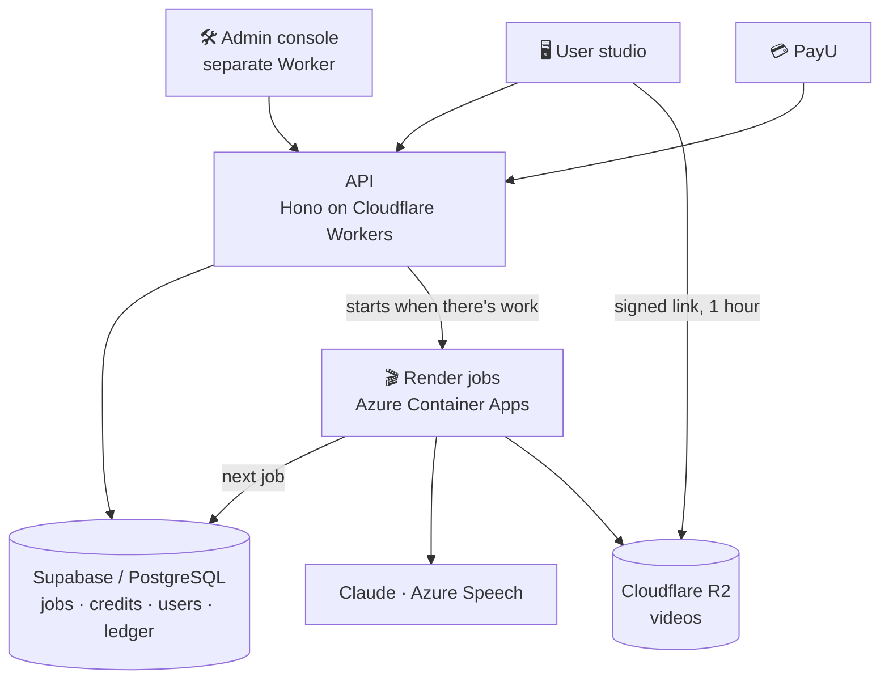
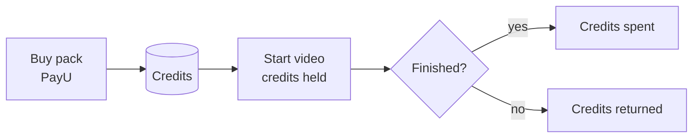

<h1 align="center">MotionMint</h1>

<b>Type one sentence. Get a narrated, animated explainer video.</b> 
English, Hindi or Hinglish · vertical or landscape · built from scratch, first version in 2 days.

<table align="center">
<tr><th>UPI PIN (Hindi)</th><th>QR codes (English)</th></tr>
<tr>
<td></td>
<td></td>
</tr>
<tr>
<td align="center"><a href="upi-pin-hindi.mp4">▶ Watch with sound</a></td>
<td align="center"><a href="qr-code-english.mp4">▶ Watch with sound</a></td>
</tr>
</table>

> The source code is private. This repo explains what it does and how it works.

---

## 📊 At a glance

| | |
|---|---|
| **Input** | One sentence, a web link, or your own script |
| **Output** | MP4 with voice, captions, music, sound effects, plus an `.srt` file |
| **Languages** | English, Hindi, Hinglish |
| **Formats** | Vertical 9:16 (Reels, Shorts) or landscape 16:9 (YouTube) |
| **Length** | As long as needed (usually 1–2 min) or fixed 15, 30, 45 or 60 seconds |
| **Pipeline** | 11 stages, including fact checking and automatic quality review |
| **Cost to make** | About ₹70 for a 1.5 minute video |
| **Apps** | User studio (11 pages) and admin console (11 pages) |

---

## 🎬 From one line to a finished video

The UPI video explains payments through Ramu's chai stall: your phone, your bank, the network in between, and why your PIN stays safe. Objects stay on screen and move with the voice, so it feels like one animation instead of a slideshow.

---

## 🎛️ Video options

| Option | Choices |
|---|---|
| **Source** | Research it (web search, only facts it can link to) · From a link · My own script (40–6,000 characters) |
| **Language** | English · Hindi · Hinglish |
| **Length** | As long as needed · 15s · 30s · 45s · 60s |
| **Format** | Vertical 9:16 · Landscape 16:9 |
| **Tone** | Educational · Investigative · Calm · Hype · Funny |
| **Voice** | Female · Male |
| **Captions** | On or off · Highlight, Plain or Bold · Roman or Devanagari |
| **Extras** | Guide mascot · Sound effects · Skip script review |

Write the prompt naturally ("a 30 second Hindi reel on credit scores, funny tone") and the settings fill in by themselves.

---

## 🖥️ User studio (11 pages)

| Page | What you can do |
|---|---|
| **Landing** | How it works, sample videos, use cases, languages, pricing, FAQ |
| **Log in · Sign up · Forgot / reset password** | Account access |
| **Home** | Prompt box, example topics, scripts waiting for review, videos in progress, recent videos, credits |
| **Videos** | Library with search, language and format filters, bulk retry or delete |
| **New video** | Describe it, adjust settings, see credits left after |
| **Project** | Live progress, script editor per scene, sources with links, quality report, download MP4 and captions |
| **Credits & billing** | Credit packs via PayU, billing history, credit activity, automatic refunds |
| **Settings** | Profile, brand (end-card handle, accent colour, mascot), theme, shortcuts, password |

## 🛠️ Admin console (11 pages)

| Page | What it shows |
|---|---|
| **Overview** | Revenue, AI and compute spend, cost and margin per video, time to video, spend by stage |
| **Videos / Video detail** | Every video with cost by stage and model, pacing repairs, errors, files |
| **Queue & failures** | What's rendering now, failures in the last 24 hours, workers |
| **Users / User detail** | Credits, spend, margin, success rate; grant credits, suspend, change role |
| **Payments** | PayU orders and manual reconciliation |
| **Credits ledger** | Every credit movement with the balance after it |
| **Usage & costs** | Spend by provider and model, active users, most expensive videos |
| **Settings** | Sign-ups, maintenance mode, limits, credit packs and prices, cost alerts, video retention |
| **Audit log** | Every admin action, who did it and what changed |

---

## ⚙️ How it runs

| | |
|---|---|
| **Pay only while rendering** | Render jobs start when there's work and shut down when there isn't. No fixed server bill. |
| **Queue in Postgres** | Workers take the next job with `FOR UPDATE SKIP LOCKED`, so two never take the same one |
| **Safe credits** | Balance can't go below zero; charges, refunds and purchases run only on the server, each once |
| **Auto refunds** | Failed videos give the credits back |
| **Expiring links** | Videos are shared through signed links that expire in an hour |

---

## 💭 What I learned

My first videos looked like slideshows, a new picture every few seconds. They only started to feel like real animation once the whole video became one scene where things stay and move with the voice.

---

Shivam Kumar · <a href="mailto:proffesorrk@gmail.com">proffesorrk@gmail.com</a> · <a href="https://www.linkedin.com/in/shivam-kumar-28b40b306/">LinkedIn</a>

